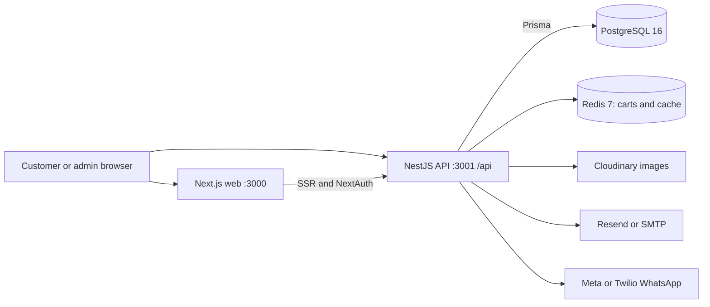

# Vibio ecommerce: technical project context

Reviewed: 2026-10-25. This document describes the checked-in implementation through static source inspection. It does not certify that the application builds, that external services are configured, or that a deployed database matches the schema. No live credentials are reproduced here.

## 1. Product and scope

Vibio is a Moroccan premium natural-products shop: dates and sweet treats, chocolate, coffee and tea, herbal infusions, natural beauty, and gifts. Prices and loyalty discounts use Moroccan dirhams (MAD). The repository contains a customer storefront and an administration interface in the same Next.js application, backed by a separate NestJS REST API.

Customers can browse/search products, choose variants, maintain a guest cart, register/sign in, check out, view orders, manage addresses, save wishlist items, submit reviews, and use loyalty points. Contact, callback, newsletter, product-inquiry, and order-modification forms feed a persistent admin inbox and owner notifications. There is also a blog and physical-store information.

The implemented checkout requires authentication and currently offers cash on delivery. Card payment is disabled with a coming-soon message. Stripe variables in `.env.example` are placeholders for future work; there is no Stripe dependency, payment module, or webhook flow in the inspected source.

## 2. How to use this context

- Start here when onboarding or preparing a change; use the linked source files to verify the affected behavior.
- [../context.md](../context.md) is the earlier design/specification document. Some of its brand placeholders, tokens, endpoints, components, and implementation claims are outdated. Treat it as historical intent when it conflicts with code.
- [../CLAUDE.md](../CLAUDE.md) contains frontend design guidance, including references to tooling that is not present in this repository. This is a Next.js/NestJS application, not the single-file HTML project described in parts of that guidance.
- Other deployment, performance, email, and Google setup notes are supporting documents, not proof of the current deployed state. Recheck their commands against package scripts and Dockerfiles.
- Update this document when architecture, business rules, environment requirements, or important limitations change.

## 3. Architecture and stack



| Layer | Implementation |
| --- | --- |
| Web | Next.js 14.2.3 App Router, React 18, TypeScript |
| UI | Tailwind CSS 3, Radix dependencies, Lucide icons, Framer Motion, Sonner toasts |
| Client data | Axios API wrapper and TanStack React Query 5 |
| Forms | React Hook Form and Zod, including checkout address validation |
| Sessions | NextAuth 4 JWT sessions containing backend token information |
| API | NestJS 10, Express, Passport, JWT, class-validator/class-transformer |
| Persistence | Prisma 5 and PostgreSQL; Redis through ioredis for carts |
| Read caching | Nest cache-manager with a configured KeyvRedis store; runtime effectiveness is unverified |
| Admin charts | Recharts |
| Runtime | Node 20 Alpine in Docker, Docker Compose for service orchestration |

There is no root npm workspace/package script. `api/` and `web/` each have their own `package.json` and npm lockfile.

## 4. Repository map

| Location | Responsibility |
| --- | --- |
| `api/src/main.ts` | API bootstrap, CORS, Helmet, compression, validation, `/api` prefix, Swagger |
| `api/src/app.module.ts` | Module composition, configuration, cache and throttler setup |
| `api/src/common/prisma/` | Shared Prisma provider |
| `api/src/auth/` | Registration, passwords, JWT issuance/refresh, Google auth, authorization guards |
| `api/src/products/`, `categories/`, `cart/`, `orders/` | Core catalog and purchase flow |
| `api/src/promo/`, `loyalty/` | Promotion validation and loyalty ledger |
| `api/src/users/`, `wishlist/`, `reviews/` | Customer account features and review moderation |
| `api/src/submissions/`, `notifications/` | Customer request inbox and email/WhatsApp delivery |
| `api/src/blog/`, `banners/`, `upload/`, `stats/` | Content, media and admin analytics |
| `api/prisma/schema.prisma` | Canonical database model |
| `api/prisma/seed.ts` | Demo catalog, accounts and related sample content |
| `web/app/` | App Router pages, layouts, error/loading boundaries and metadata |
| `web/components/` | Layout, storefront, account, admin, home and shared components |
| `web/lib/api.ts` | Browser Axios instance, session/token handling, API methods and guest identity |
| `web/lib/auth.ts` | NextAuth providers, backend login/exchange and token refresh callbacks |
| `web/lib/serverApiUrl.ts` | Server-side API origin selection |
| `web/hooks/useCart.ts`, `useWishlist.ts` | Query-backed cart and wishlist behavior |
| `web/types/index.ts` | Frontend domain/response types; verify against actual API payloads |
| `web/lib/i18n/` | French/Arabic configuration and translation dictionaries |
| `web/public/`, `brand_assets/` | Logos, catalog imagery, reference brand assets |
| `docker-compose*.yml`, per-app Dockerfiles | Local infrastructure and container deployment |

## 5. Frontend routing and conventions

`(storefront)` is a route group: its name does not appear in public URLs. Its shared layout supplies the storefront shell.

| Area | Routes |
| --- | --- |
| Shopping | `/`, `/shop`, `/shop/[slug]` for categories, `/products/[slug]`, `/gifts`, `/cart`, `/checkout`, `/wishlist` |
| Customer | `/account`, `/account/orders`, `/account/orders/[id]`, `/account/addresses`, `/account/settings`, `/account/loyalty` |
| Information | `/about`, `/store`, `/contact`, `/blog`, `/blog/[slug]`, `/privacy`, `/terms`, `/returns` |
| Authentication | `/login`, `/register`, `/forgot-password`, `/reset-password`, `/auth/callback`; NextAuth handler at `/api/auth/[...nextauth]` |
| Administration | `/admin`, products/new/edit, categories, stock, orders/detail, customers/detail, promo, banners, blog, reviews, submissions and content |

`web/middleware.ts` protects `/account/*`, `/checkout/*`, and `/admin/*`, and checks `ADMIN` for admin pages. API guards independently enforce backend access. The Next.js `/api/auth/*` routes and NestJS `/api/*` routes belong to different servers.

`web/app/providers.tsx` supplies NextAuth, React Query, language context, cookie consent and toast rendering. Query defaults use a two-minute stale time, ten-minute garbage collection, no automatic retry, and refetch on window focus/reconnect. Catalog and order screens add targeted refetch/invalidation behavior.

Server components fetch from `SERVER_API_URL`; interactive components use `web/lib/api.ts`. Product details and category pages fetch fresh server data, then client queries keep category/product data current. Admin catalog/order views and customer order views invalidate affected React Query keys after mutations and periodically refetch where cross-session changes must appear without navigation. Metadata, an Open Graph image, dynamic sitemap and robots rules exist; this does not establish complete SEO coverage.

Frontend imports use `@/` relative to `web/`; API TypeScript maps `@/` to `api/src/`. Frontend TypeScript enables strict mode; backend settings are more permissive.

### Language and visual system

French is the i18next default, with Arabic and RTL support. Language preferences are independent: `vibio-lang` for storefront and `vibio-admin-lang` for admin. Preferences apply after mounting to keep initial server/client markup aligned. Some English strings and English root metadata remain; translation coverage is not complete.

Current Tailwind tokens use green (`#5B8A3A`), dark green (`#1F3815`), gold (`#C9A36B`) and warm cream surfaces. Heading/body fonts are Cormorant Garamond and Manrope; the root also loads Plus Jakarta Sans. Use `web/tailwind.config.ts`, `web/app/globals.css`, and existing components as the current design reference rather than copying the older context document's palette/fonts.

Images use `next/image`, often through `OptimizedImage`. Remote hosts are explicitly allowed in `web/next.config.js`; new external image hosts require configuration. Physical-store details are centralized in `web/lib/storeConfig.ts` and consumed by store/contact components, with environment overrides and placeholder fallbacks.

## 6. Backend contracts and authorization

The API listens on `0.0.0.0`, using `PORT` or 3001. All controller routes have an `/api` prefix. Swagger is exposed at `/api/docs`. Browser CORS origins come from an explicit list including `NEXT_PUBLIC_SITE_URL` and several local/demo origins.

The global ValidationPipe strips/forbids unknown DTO fields and enables transformation. Many handlers still use inline TypeScript body types; these do not provide the same runtime validation as decorated DTO classes. A throttler module is configured, but an application-wide throttler guard is not registered in `AppModule`. Submission controllers explicitly apply `ThrottlerGuard` with 20 requests per minute.

| API family, excluding `/api` | Access and purpose |
| --- | --- |
| `/auth/*` | Public registration/login/reset and Google endpoints; protected refresh/logout/me as appropriate |
| `/products`, `/products/featured`, `/products/:slug` | Public catalog; writes and `/products/by-id/:id` require admin |
| `/categories` | Public reads; admin writes |
| `/cart`, `/cart/items/:variantId` | Optional JWT, otherwise `x-session-id`; `/cart/merge` requires JWT |
| `/orders`, `/orders/:id` | JWT; customer order list/detail/create |
| `/admin/orders`, `/admin/orders/:id/status` | Admin list/detail and status changes |
| `/wishlist`, `/wishlist/:productId` | JWT; read/toggle/remove |
| `/products/:id/reviews`, `/reviews/recent` | Public review reads; JWT submission; admin moderation under `/admin/reviews` |
| `/account/profile`, `/account/addresses` | JWT profile/address operations |
| `/admin/customers`, `/admin/stats/*` | Admin customer records and analytics |
| `/promo/validate`, `/admin/promo` | Public promo preview; admin management |
| `/loyalty/me` | JWT balance, rules and recent ledger |
| `/submissions/*`, `/admin/submissions` | Public forms and protected order modification; admin inbox/handled flag |
| `/blog`, `/admin/blog` | Public published content and admin editing |
| `/banners`, `/banners/admin` | Public active banners and admin management |
| `/upload` | JWT-protected image upload to Cloudinary |

Responses are not uniformly wrapped: product lists return `{ products, total, page, limit, pages }`; order lists use `{ orders, total, page, pages }`; other resources have their own shapes. Axios unwraps `response.data`. Check controllers/services before relying on a generic frontend pagination type.

## 7. Database model

Prisma uses PostgreSQL, CUID identifiers, mapped snake_case table names, and `Decimal(10,2)` monetary columns. JSON responses may serialize decimals as strings; callers frequently convert them with `Number(...)`. Business calculations currently use JavaScript numbers.

| Models | Important relationships and state |
| --- | --- |
| `User`, `Address` | Unique email, CUSTOMER/ADMIN role, optional password for OAuth, saved addresses, hashed refresh token, reset token/expiry, cached loyalty balance |
| `Category` | Self-referencing parent/children tree, unique slug and display order |
| `Product`, `Variant`, `Tag` | Product belongs to a category; variants own sellable price/stock/SKU; tags shared with blog posts; soft activation/featured flags and SEO fields |
| `Order`, `OrderItem` | User-owned order, independent order/payment status, shipping-address JSON, totals, promo and loyalty fields, item snapshots plus product/variant references |
| `PromoCode` | Percentage/fixed/free-shipping, date window, minimum spend, optional discount cap and usage limit |
| `LoyaltyTransaction` | Signed EARN/REDEEM/REVERSE ledger linked to user and optionally order |
| `Review` | One review per user/product, approval flag, optional displayed reviewer name |
| `Wishlist` | Unique user/product pair |
| `Banner` | Desktop/mobile images, CTA, schedule and active/order fields |
| `BlogPost` | DRAFT/SCHEDULED/PUBLISHED/ARCHIVED status, publish/schedule dates, tags and SEO fields |
| `Submission` | Request type, contact/message fields, optional user/order/product IDs, metadata and handled flag |

`OrderStatus`: PENDING, CONFIRMED, PROCESSING, SHIPPED, DELIVERED, CANCELLED, REFUNDED. `PaymentStatus`: PENDING, PAID, FAILED, REFUNDED. `PAID` is not an order-status enum value.

There is no checked-in `api/prisma/migrations/` history. `api/migration.sql` is an older standalone SQL snapshot, not a complete representation of the current model. The schema and current startup path use `prisma db push`.

## 8. Core workflows and business rules

### Authentication

1. NextAuth credentials login calls the backend `/api/auth/login` server-side.
2. NestJS checks a bcrypt password hash and issues access/refresh JWTs; defaults are 15 minutes and seven days. A hash of the current refresh token is stored on the user.
3. NextAuth keeps token information in its JWT session, exposes the access token to the client session, and refreshes near expiry. A new login/refresh replaces the stored refresh hash, so refresh-token storage is one value per user.
4. The browser Axios wrapper attaches bearer tokens and `x-session-id`. It caches/deduplicates session retrieval and retries a 401 once after refreshing the session.
5. NextAuth Google login calls `/auth/google/exchange`; a separate NestJS Google redirect/callback path also exists. See the limitations below before treating Google exchange as a trusted boundary.
6. Password-reset links expire after one hour; the current implementation stores the token directly and logs the reset URL.

### Catalog and inventory

Listing supports category slug, text search, price range, in-stock filtering, sort and pagination. Public lists include only the cheapest variant; admin-shaped lists include all variants. Search uses case-insensitive substring matching, despite a `tsvector` column/GIN index in the schema. The declared `tags` query field is not applied in the inspected listing service.

Products are soft-deleted by setting `isActive=false` and `deletedAt`. Admin listings include inactive products but exclude deleted ones; public product queries require active, non-deleted products. Stock resides on variants. Historical product rows remain available for order records after deletion, and their category relation is nullable so deleting an otherwise-empty category can preserve those records.

### Cart

Guests receive a browser UUID stored as `localStorage.sessionId`, sent in `x-session-id`. Authenticated cart identity is the backend user ID. Redis stores serialized item/price/stock snapshots at `cart:<identity>` for seven days, refreshed on save. The backend falls back to a shared `guest` key when no identity is supplied; the normal browser client supplies an ID.

Adding/changing quantity checks variant availability and stock. The frontend merges the guest cart into the user cart after sign-in and updates the matching React Query cache. Merge uses stored item/stock snapshots. Redis is operational storage for carts, so losing Redis data can lose carts even when PostgreSQL is intact.

### Checkout and orders

1. The frontend guides customers through address, shipping, payment and review steps. It generates a stable idempotency key for that mounted checkout.
2. The protected order endpoint reads the user's Redis cart. Promo eligibility and loyalty redemption are recomputed server-side.
3. Standard shipping is **50 MAD**, or free when the pre-discount subtotal is **strictly greater than 500 MAD**. A free-shipping promo also waives it. Exactly 500 MAD still incurs shipping under the backend rule.
4. Merchandise is reduced by promo discount, then loyalty discount, clamped to zero; shipping is added afterward.
5. A Prisma transaction creates the order and item snapshots, decrements variant stocks, claims promo usage and debits redeemed points. Conditional updates protect promo usage and loyalty spending.
6. A unique idempotency key returns the existing order on repeat creation, including a concurrent unique-key conflict path. See the ownership limitation below.
7. After commit, Redis cart clearing and customer/owner notifications run. These steps are outside the database transaction.

Admin status changes set payment to PAID on DELIVERED and REFUNDED on REFUNDED, trigger loyalty award/reversal and send a shipping email on SHIPPED. The current path does not restore stock or promo usage on cancellation/refund and does not enforce a full status transition graph.

### Promotions and loyalty

Promo validation is case-insensitive and checks activation, date window, minimum order and usage limit; percentage discounts can be capped. The preview is advisory; order creation validates again and claims usage transactionally.

Default loyalty rules: 1 point per MAD of eligible merchandise spend; 100 points redeem for 10 MAD; redemption uses blocks of 100 with a minimum of 100. Shipping earns no points and cannot be paid with points. Environment overrides live in `api/src/loyalty/loyalty.config.ts`.

The signed ledger records every movement while `User.loyaltyPoints` holds the running balance. Delivery/payment eligibility drives earning; cancellation/refund reverses earned points and returns redeemed points. Earning/reversal contain repeat-call checks, but no unique database constraint or explicit serialization guarantees exactly-once behavior under concurrent calls.

### Notifications, requests and content

- Email providers support Resend, SMTP, auto selection and a logging fallback. WhatsApp supports Meta Cloud API, Twilio, auto selection and logging. Missing providers can leave the app functional without delivering messages.
- Customer notifications cover welcome, reset, order confirmation and shipping. Owner notifications use configurable recipients. `ADMIN_ORDER_NOTIFY_ON=created|paid` controls when new-order alerts are attempted; COD alerts are immediate.
- `adminNotifiedAt` is claimed before dispatch. This suppresses duplicate attempts, but a failed delivery is not automatically retried. It records an attempted dispatch, not a delivery receipt. There is no durable queue/outbox.
- Form submissions are persisted before owner notifications. Public forms use a honeypot and throttling; newsletter deduplication checks existing records; order-modification requests verify ownership. The inbox can mark a submission handled. A modification request does not itself alter an order.
- Blog publication is evaluated on reads, including due scheduled posts, with best-effort promotion to PUBLISHED; no background scheduler is required by that implementation. Cache TTL can delay visibility.
- Admin stats use PostgreSQL aggregates and short caching; overview revenue/order metrics filter PAID orders. They are business aggregates, not browser analytics or a demonstrated conversion-tracking system.

## 9. Cache behavior

Product list responses are read directly from PostgreSQL rather than cached, so product edits and status changes are not hidden behind stale list keys. Featured products and product details still use the API cache and are invalidated by catalog writes. Category reads use cached responses with targeted invalidation; product changes clear category counts, and category slug changes retain an alias so old storefront links can resolve to the renamed category.

The browser invalidates relevant product, stock, category, order and dashboard queries after mutations, refetches on window focus/reconnect, and periodically refreshes long-lived catalog/order views. Storefront product and category server fetches use no-store behavior. Cart contents are refreshed from current product/variant data when read. These measures address application-level stale reads; cross-instance Redis behavior and the running deployment still require runtime verification.

## 10. Local development setup

Use Node 20/npm and Docker for the local infrastructure. Inspect existing environment files before editing them; never overwrite configured secrets with example values.

1. Start only the local dependencies from the repository root:

   ```powershell
   docker compose -f docker-compose.dev.yml up -d
   ```

   This exposes PostgreSQL on 5432, Redis on 6379 and Adminer on 8080. Avoid starting both Compose stacks together because their host ports overlap.

2. Configure `api/.env` using the relevant names in root `.env.example`: local `DATABASE_URL`, `REDIS_URL`, `JWT_SECRET`, `JWT_REFRESH_SECRET`, and `NEXT_PUBLIC_SITE_URL`. Optional provider credentials enable email, WhatsApp, uploads and Google OAuth. Native API startup loads its working directory's `.env`; the root `.env` is used by the full Compose configuration.

3. Configure `web/.env.local` with `NEXT_PUBLIC_API_URL=http://localhost:3001`, `NEXT_PUBLIC_SITE_URL=http://localhost:3000`, `NEXTAUTH_URL=http://localhost:3000`, and `NEXTAUTH_SECRET`. Add Google credentials if testing Google sign-in. API-origin variables exclude the `/api` suffix because callers append it.

4. In `api/`, install dependencies and prepare a disposable development database:

   ```powershell
   npm ci
   npm run db:generate
   npm run db:push
   npm run db:seed
   npm run start:dev
   ```

   Seed only an intended demo database. Parts of the seed create additional rows on rerun; it is not globally idempotent. Account/bootstrap scripts contain fixed demo credentials; do not reuse them as production identity configuration.

5. In a second terminal, run the frontend from `web/`:

   ```powershell
   npm ci
   npm run dev
   ```

6. Open `http://localhost:3000`; inspect API documentation at `http://localhost:3001/api/docs`. These are setup instructions inferred from source, not commands executed during this documentation review.

### Environment groups

| Group | Key names / source |
| --- | --- |
| Core API | `DATABASE_URL`, `REDIS_URL`, `PORT`, `JWT_SECRET`, `JWT_REFRESH_SECRET`, `JWT_EXPIRES_IN`, `JWT_REFRESH_EXPIRES_IN` |
| Web/session | `NEXTAUTH_SECRET`, `NEXTAUTH_URL`, `NEXT_PUBLIC_API_URL`, `INTERNAL_API_URL`, `NEXT_PUBLIC_SITE_URL` |
| Google | `GOOGLE_CLIENT_ID`, `GOOGLE_CLIENT_SECRET`; confirm redirect configuration against the chosen auth path |
| Email | `EMAIL_PROVIDER`, `EMAIL_FROM`, `RESEND_API_KEY`, or `SMTP_HOST/PORT/SECURE/USER/PASS` |
| Owner alerts | `STORE_NOTIFICATION_EMAIL`, `STORE_NOTIFICATION_PHONE`, `STORE_WHATSAPP_NUMBER`, `ADMIN_ORDER_NOTIFY_ON`, `ADMIN_SITE_URL` |
| WhatsApp | `WHATSAPP_PROVIDER`, `WHATSAPP_API_TOKEN`, `WHATSAPP_PHONE_NUMBER_ID`, optional `WHATSAPP_API_VERSION`, or `TWILIO_ACCOUNT_SID/AUTH_TOKEN/WHATSAPP_FROM` |
| Images | `CLOUDINARY_CLOUD_NAME`, `CLOUDINARY_API_KEY`, `CLOUDINARY_API_SECRET` |
| Loyalty | `LOYALTY_POINTS_PER_MAD`, `LOYALTY_REDEEM_STEP`, `LOYALTY_REDEEM_STEP_VALUE`, `LOYALTY_MIN_REDEEM` |
| Store contact | `NEXT_PUBLIC_STORE_*`; see `web/lib/storeConfig.ts` and contact components for exact usage |

The example environment is a starting point, not an exhaustive or validated configuration schema. `NEXT_PUBLIC_DEBUG_PERF=1` enables optional browser API timing instrumentation.

## 11. Container/deployment behavior

The full `docker-compose.yml` starts PostgreSQL, Redis, API and web; Adminer is under the `dev` profile. The API waits for database/Redis health checks. Docker DNS names (`postgres`, `redis`, `api`) work between containers; browsers need publicly reachable origins.

`SERVER_API_URL` selects `INTERNAL_API_URL`, then `NEXT_PUBLIC_API_URL`, then localhost. In Compose, server-side web calls use `http://api:3001`, while the local browser uses `http://localhost:3001`.

`NEXT_PUBLIC_*` values are compiled into browser bundles. `web/Dockerfile` declares build arguments for the public API/site/contact values, but current Compose does not explicitly pass those build arguments. Runtime environment values alone do not configure an already built client bundle. Check the effective build inputs and `.env.local` handling before deployment. `storeConfig.ts` uses dynamic `process.env[key]` lookups; those public overrides also need browser-bundle verification because Next.js normally inlines direct environment references.

The API Docker entrypoint runs `prisma db push --skip-generate --accept-data-loss`, conditionally seeds if product count is zero, then runs `node dist/src/main`. The data-loss flag permits destructive schema synchronization; this is the current behavior, not a recommended production migration policy. The package `start:prod` script instead points at `dist/main`, which differs from the Docker entrypoint and documented emitted structure.

Next.js uses standalone output, copied into the web runtime image. Build-time lint is disabled in Next config; TypeScript checking remains enabled. Production domains, provider availability, backups, monitoring and deployed schemas were not inspected.

## 12. Known gaps and constraints for future changes

These observations come from source inspection and are not fixes made by this documentation task.

| Area | Current limitation / implication |
| --- | --- |
| Google exchange | Public `/auth/google/exchange` accepts email/name/image and calls `googleLogin` without verifying a Google identity token or authenticating the caller. CORS does not establish caller identity. This boundary needs attention before relying on OAuth account ownership. |
| Order idempotency | Lookup by unique idempotency key is not scoped to the authenticated user before returning an existing order. Preserve retry handling while adding ownership checks in future work. |
| Checkout inventory/prices | Order creation now reloads current variant/product availability and price, then conditionally decrements stock in the transaction. Validate this behavior with concurrent checkout tests before production rollout. |
| Express shipping | Frontend previews 99 MAD for express, but sends no shipping method; backend always uses its standard-shipping calculation. |
| Product editing/stock | Product updates synchronize submitted variants transactionally and preserve historical order snapshots when variants are removed. Admin listings include inactive products but exclude soft-deleted products; public product reads exclude both. |
| Catalog visibility | Public catalog and category counts include active, non-deleted products only. Category deletion is rejected while non-deleted products or child categories remain; soft-deleted product rows are retained with a null category relation. Renamed category slugs resolve through aliases. |
| Content editor | `/admin/content` uses local state and a simulated save delay; no persistence or shared content/settings model backs it. |
| Account contracts | Frontend helpers declare password-change and default-address endpoints that are absent from the inspected users controller. Check the specific UI path and payload before using these helpers. |
| Status/payment | No payment gateway/webhook exists. The status service contains a `PAID` order-status branch even though the enum excludes PAID; delivery is the implemented path that marks payment paid. |
| Reversals/concurrency | Cancel/refund does not restore stock/promo usage. Loyalty repeat-call guards do not establish a concurrency guarantee. |
| Notification reliability | At-most-once owner dispatch claims can suppress retry after delivery failure; order post-commit operations can fail after an order already exists. |
| Validation/security | Inline body types lack DTO runtime constraints; generic upload requires JWT rather than admin; reset links are logged. Review these concrete boundaries when changing auth, upload or order input. |
| Schema lifecycle | A migration now records the category slug-alias table, but startup still uses `prisma db push --accept-data-loss` and may seed demo data. Review deployment policy before release. |
| Documentation drift | Older root context/SQL/deployment notes include assumptions that differ from current source. |

## 13. Verification and a starting point for later work

The implementation work inspected and updated the catalog, category, cart, order, statistics and navigation flows, along with the schema and this document. No live database or external service was contacted. API/web builds and Prisma validation could not run because the command runner has no PowerShell executable. Automated regression tests and browser/runtime flows remain unverified.

No test/spec files were found in the inspected repository file inventory. The API declares `test: jest` without declaring Jest itself in package dependencies. Do not treat that script as evidence of a working suite. Future code changes should run the relevant app build/type checks and focused flow checks; inspect lint configuration first because backend lint uses `--fix` and frontend builds skip lint.

Useful first reads for future tasks:

1. Backend composition: [app.module.ts](../api/src/app.module.ts), [main.ts](../api/src/main.ts), [schema.prisma](../api/prisma/schema.prisma).
2. Session/API behavior: [auth.ts](../web/lib/auth.ts), [api.ts](../web/lib/api.ts), [middleware.ts](../web/middleware.ts).
3. Purchase flow: [useCart.ts](../web/hooks/useCart.ts), [cart.service.ts](../api/src/cart/cart.service.ts), [checkout/page.tsx](../web/app/(storefront)/checkout/page.tsx), [orders.service.ts](../api/src/orders/orders.service.ts).
4. Business incentives: [promo.service.ts](../api/src/promo/promo.service.ts), [loyalty.service.ts](../api/src/loyalty/loyalty.service.ts), [loyalty.config.ts](../api/src/loyalty/loyalty.config.ts).
5. Customer requests and delivery: [submissions.service.ts](../api/src/submissions/submissions.service.ts), [notifications.service.ts](../api/src/notifications/notifications.service.ts).
6. Deployment: [docker-compose.yml](../docker-compose.yml), [API entrypoint](../api/docker-entrypoint.sh), [web Dockerfile](../web/Dockerfile).
